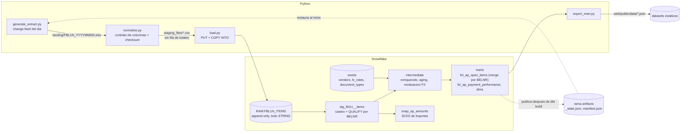
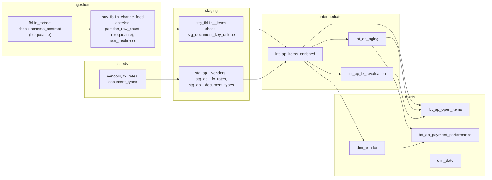

# Pipeline ELT incremental de cuentas a pagar

Pipeline diario que ingesta el extracto de partidas individuales de acreedores
de SAP FI-AP (transaccion **FBL1N**), lo modela en Snowflake con dbt y deja
los agregados listos para un tablero estatico.

Los datos son sinteticos. El generador esta versionado en el repo como prueba
de procedencia.

**Tablero:** <https://joelsuarez33.github.io/AP-Invoices-Snowflake/>
**Documentacion de dbt, con el grafo de linaje navegable:**
<https://joelsuarez33.github.io/AP-Invoices-Snowflake/dbt/>

Las dos se republican despues de cada corrida del pipeline, desde la rama
`gh-pages`.

**Agente de consulta:** preguntas en lenguaje natural desde la terminal
(`python -m agent.chat`). Claude responde llamando a herramientas tipadas sobre
el ledger, sin escribir SQL, y cada respuesta queda auditada con el SQL que
ejecuto. Casos de uso, verificacion manual (SQL y Excel), auditoria e
idempotencia: [docs/AGENTE.md](docs/AGENTE.md).

---

## Que problema resuelve

FBL1N no expone un feed de cambios: es una pantalla. Lo que se exporta todos
los dias es un archivo con las partidas que se movieron ese dia. Eso lo
convierte en un **change feed**, no en un snapshot:

| Lo que trae el extracto | Lo que obliga a hacer |
|---|---|
| El mismo `BELNR` vuelve con datos distintos cuando se corrige o se compensa | RAW guarda todas las versiones y el estado actual se resuelve con `QUALIFY` |
| Una compensacion es un UPDATE sobre una partida que ya se cargo | Un delta de solo altas no alcanza |
| Documentos con `BUDAT` de 15 a 45 dias atras | El filtro incremental no puede ir por fecha contable |
| `VERZN` lo calcula el report al ejecutarse | El aging se recalcula contra la fecha de corte del ledger |
| Tres monedas de documento y una moneda local | Toda metrica agregada va en `DMBTR` |
| Una fila de totales al pie, con `*` en moneda de documento | Checksum contra moneda local, y la fila no llega a RAW |

Cada una de estas decisiones esta desarrollada en
[docs/DECISIONS.md](docs/DECISIONS.md), con las alternativas que descarte.

---

## Flujo



La orquestacion es **Dagster**: ingesta y dbt como assets particionados por
dia, con backfills, asset checks y manejo de cambios de schema. GitHub Actions
solo le da un runner y un horario. Detalle en [Orchestration](#orchestration-dagster).

---

## Mapeo del extracto: encabezado en espanol a campo SAP

El extracto se exporta con la variante de layout de FBL1N en espanol. Las 24
columnas son el contrato de [`contracts/fbl1n_extract.yml`](contracts/fbl1n_extract.yml),
que el schema check valida por nombre y por tipo antes de cargar nada. Las tres
ultimas llegaron con la version 2 del contrato, desde el 2026-10-07.

| # | Encabezado en el xlsx | Campo SAP | Uso en el pipeline |
|---|---|---|---|
| 1 | Icono part.abiertas/comp. | `ICON_STATUS` | Vacio en el detalle; en la fila de totales trae el marcador `@5C\QPendientes@` |
| 2 | Acreedor | `LIFNR` | Clave hacia `vendors` (texto, no numero) |
| 3 | Clave de referencia | `KIDNO` | Estable entre re-emisiones |
| 4 | Referencia | `XBLNR` | Referencia del proveedor |
| 5 | Nº documento | `BELNR` | Clave del merge y del `QUALIFY` |
| 6 | Clave referencia 1 | `XREF1` | Siempre vacio en esta variante |
| 7 | Vía de pago | `ZLSCH` | Siempre vacio en esta variante |
| 8 | Bloqueo de pago | `ZLSPR` | Siempre vacio en esta variante |
| 9 | Demora tras vencimiento neto | `VERZN` | Calculo del report, no confiable: `verzn_report_unreliable` |
| 10 | Importe en moneda doc. | `WRBTR` | No se agrega entre monedas |
| 11 | Moneda del documento | `WAERS` | `ARS`, `USD`, `EUR` |
| 12 | Importe en moneda local | `DMBTR` | Importe de referencia de toda metrica agregada |
| 13 | Moneda local | `HWAER` | Siempre `ARS` |
| 14 | Fecha de documento | `BLDAT` | Fecha de la cotizacion del documento |
| 15 | Fe.contabilización | `BUDAT` | Llega atrasada en los late-arriving |
| 16 | Vencimiento neto | `NETDT` | Base del aging |
| 17 | Fecha compensación | `AUGDT` | Nula = partida abierta |
| 18 | Doc.compensación | `AUGBL` | Compartido por las partidas de un mismo lote de pago |
| 19 | Clase de documento | `BLART` | `KR`, `RE`, `KG`, `KZ` |
| 20 | Nombre del usuario | `USNAM` | Usuario que contabilizo |
| 21 | Cta.contrapartida | `GKONT` | Cuenta de mayor de contrapartida |
| 22 | Sociedad | `BUKRS` | Clave del documento (v2). Derivada (1000) en extractos anteriores |
| 23 | Ejercicio | `GJAHR` | Clave del documento (v2). Derivado del ano de `BUDAT` en anteriores |
| 24 | Posición | `BUZEI` | Clave del documento (v2). Derivada (1) en extractos anteriores |

Las fechas llegan a RAW como texto `DD.MM.YYYY`, tal como las muestra SAP. El
unico lugar que castea es `stg_fbl1n__items`.

---

## Numeros verificados

### Dataset base

`scripts/enrich_baseline.py` genera el extracto inicial con semilla fija:

- 5.000 partidas, ledger al 2026-07-08.
- 40 acreedores con distribucion Pareto: los 5 primeros concentran cerca del
  57% del volumen.
- Clases de documento: `KR` 3.768, `RE` 728, `KZ` 285, `KG` 219. `KR` y `RE`
  van con signo negativo (haber); `KG` y `KZ`, positivo (debe).
- Moneda de documento: ARS 70%, USD 20%, EUR 10%. `WRBTR = DMBTR / cotizacion`
  a `BLDAT`.
- Total: -21.945.446.773,62 ARS.
- Aging de abiertas: 959 no vencidas, 656 de 1 a 30 dias, 667 de 31 a 60, 661
  de 61 a 90 y 688 de mas de 90.

### Cierre del backfill (61 dias, 2026-07-08 a 2026-09-06)

- 6.827 documentos distintos en RAW.
- 1.837 documentos con mas de una version. `unique_stg_fbl1n__items_belnr` pasa:
  el `QUALIFY` las resuelve.
- `dbt build`: PASS=157, ERROR=0 (11 modelos, 1 snapshot, 3 seeds, 142 tests).
- `snap_ap_amounts`: 6.827 filas, sin historia SCD2. Un backfill en un solo
  build no siembra historia ([ADR-011](docs/DECISIONS.md)).

### Primeras corridas del workflow (ledger al 2026-09-12, consultado el 2026-09-13)

| | |
|---|---|
| Extractos cargados | 67 |
| Filas en RAW | 9.023 |
| Documentos | 7.002 (3.631 abiertos) |
| Documentos con mas de una version | 2.012 |
| Filas por feed diario (07/09 a 12/09) | 61, 66, 50, 78, 51, 46 |
| `dbt build` en Actions | PASS=157, ERROR=0 |
| `snap_ap_amounts` | 7.004 filas, 2 versiones cerradas |
| Revaluacion cambiaria de abiertas en USD y EUR | -182.838.690,63 ARS |
| Reintento de una corrida ya cargada | 0 archivos procesados, 0 filas duplicadas |

Estos numeros son con la serie de cotizaciones sintetica original. Desde
2026-10 la serie es la oficial del BCRA, y los 2.315 documentos en moneda
extranjera se re-expresaron a esa cotizacion como un evento del change feed
([ADR-012](docs/DECISIONS.md)). Los valores al dia y como verificarlos estan en
[docs/AGENTE.md](docs/AGENTE.md).

---

## Como correrlo

### 1. Snowflake

Generar el par de claves RSA **fuera del repo** (`*.p8` y `*.pem` estan en
`.gitignore`):

```bash
openssl genrsa 2048 | openssl pkcs8 -topk8 -inform PEM -out rsa_key.p8 -nocrypt
openssl rsa -in rsa_key.p8 -pubout -out rsa_key.pub
```

Ejecutar `sql/00_setup_account.sql` con `ACCOUNTADMIN`, reemplazando
`<<RSA_PUBLIC_KEY>>` por el contenido de `rsa_key.pub` sin las lineas
`BEGIN`/`END`. Despues, `sql/01_setup_raw.sql` con el rol `AP_PIPELINE`. Crean
el usuario de servicio `AP_PIPELINE_SVC` (`TYPE = SERVICE`, sin password), el
warehouse `AP_WH` (XS, `AUTO_SUSPEND = 60`, resource monitor de 10 creditos por
mes), la base `AP_ANALYTICS`, el stage, el file format y la tabla RAW.

### 2. Entorno local (Windows, PowerShell)

```powershell
python -m venv .venv
.venv\Scripts\activate
pip install -r requirements.txt
copy .env.example .env
```

Completar `.env` segun `.env.example`. La clave va por
`SNOWFLAKE_PRIVATE_KEY_PATH`. `LANDING_DIR`, `STAGING_DIR` y `WEB_DATA_DIR` van
vacias para usar las rutas del repo.

### 3. Correr el pipeline

Los scripts de Python cargan `.env` solos. dbt no: antes de cualquier comando
dbt hay que exportar las variables a la sesion.

```powershell
python generate_extract.py        # feed del dia siguiente a last_run_date
python normalize.py               # valida contrato y checksum, escribe los CSV
python load.py                    # PUT + COPY INTO a RAW

. .\scripts\load_env.ps1          # punto y espacio: deja las variables en la sesion
cd dbt_ap
dbt deps
dbt build                         # seeds, snapshot, modelos y tests
cd ..

python export_mart.py             # datasets JSON en web/public/data
```

`normalize.py` y `load.py` sin argumentos procesan todo lo pendiente en orden
cronologico. `load.py --dry-run` y `export_mart.py --dry-run` imprimen el SQL
sin conectarse.

### 4. Generar mas dias

El generador continua el ledger desde `landing/_state.json` y se niega a emitir
un extracto con fecha futura. Es idempotente por fecha: el RNG se siembra con
`(semilla, fecha)`, asi que la misma fecha produce el mismo archivo.

El `_state.json` versionado en `main` es el estado inicial (2026-09-06). El
vigente lo publica cada corrida del workflow en la rama `artifacts`. Para
generar en local sin divergir del ledger que ya esta en Snowflake, primero hay
que traer ese estado (y no commitearlo en `main`):

```powershell
git fetch origin artifacts
git show origin/artifacts:state/_state.json > landing/_state.json
```

```powershell
python generate_extract.py --days 5             # 5 dias desde last_run_date
python generate_extract.py --until 2026-09-20   # hasta esa fecha inclusive
```

`--date` genera una fecha puntual y solo es seguro para el dia siguiente a
`last_run_date`: si hay un hueco, el feed se arma sin los documentos de los dias
que faltan.

### 5. Un modelo o un test puntual

```powershell
cd dbt_ap
dbt build --select fct_ap_open_items
dbt test --select assert_mart_reconciles_with_raw
```

---

## Orchestration (Dagster)

Dagster orquesta la ingesta y dbt sobre Snowflake como **assets particionados
por dia**, con backfills, asset checks y manejo de cambios de schema. El
proyecto vive en [`orchestration/`](orchestration/) y sus Definitions se cargan
desde `orchestration/definitions.py`.

### Grafo de assets



Los modelos, seeds y snapshot de dbt son assets de `@dbt_assets` sobre el
manifest del proyecto. La source `sap_fi.fbl1n_items` declara en su `meta` que la
carga `raw_fbl1n_change_feed`, asi que el linaje queda conectado sin mapear nada a
mano. Los 146 tests de dbt aparecen ademas como checks de cada modelo.

| Asset check | Sobre | Bloquea lo que sigue | Que verifica |
|---|---|---|---|
| `schema_contract` | `fbl1n_extract` | si, con severidad ERROR | Columnas y tipos del extracto contra el contrato |
| `partition_row_count` | `raw_fbl1n_change_feed` | si | Cada particion cargada tiene filas en RAW |
| `raw_freshness` | `raw_fbl1n_change_feed` | no | La ultima particion no tiene mas de 1 dia de atraso |
| `stg_document_key_unique` | `stg_fbl1n__items` | no | Clave (sociedad, numero, ejercicio, posicion) unica |

Job: `fbl1n_daily` (todo el grafo con sus checks). Schedule:
`fbl1n_daily_0600_art`, 06:00 en Buenos Aires para la particion de ayer.

### Correr en local

```powershell
pip install -r requirements.txt
dagster dev                 # UI en http://localhost:3000
```

`dagster dev` carga el `.env` solo y regenera el manifest de dbt al arrancar.
`DAGSTER_HOME` (en `.env`, gitignoreado) guarda el historial de corridas; si
esta vacio usa un directorio temporal. El schedule arranca detenido: en este
repo lo dispara GitHub Actions.

Antes de generar en local, traer el estado vigente del generador, que vive en
la rama `artifacts`:

```powershell
git fetch origin artifacts
git show origin/artifacts:state/_state.json > landing/_state.json
```

### Backfill de un rango de fechas

Los tres assets usan `BackfillPolicy.single_run`: un backfill de N dias es **una
sola corrida**, que procesa los dias en orden y hace un solo `dbt build`.

- **UI:** Lineage, `Materialize all`, elegir el rango de particiones. Dagster
  lanza una corrida para el rango completo.
- **CLI:**

  ```powershell
  dagster job execute -m orchestration.definitions -j fbl1n_daily `
    --tags '{\"dagster/asset_partition_range_start\": \"2026-10-01\", \"dagster/asset_partition_range_end\": \"2026-10-03\"}'
  ```

- **GitHub Actions:** `Pipeline diario (Dagster)`, `Run workflow`, con
  `partition_start` y `partition_end`.

Reprocesar dias ya cargados no duplica filas (ver la decision 2). Un dia que no
esta archivado solo se puede generar si es el siguiente al estado del
generador; si no, `fbl1n_extract` corta con un mensaje que dice desde que dia
materializar.

### Como funciona el schema check

El contrato del extracto es [`contracts/fbl1n_extract.yml`](contracts/fbl1n_extract.yml):
encabezado, campo SAP y tipo de cada columna. Es la fuente unica del layout:
`config.py` arma de ahi las columnas que usan el generador, `normalize.py` y la
carga.

`fbl1n_extract` compara cada archivo contra el contrato antes de que nada toque
Snowflake:

| Caso | Resultado | Que pasa despues |
|---|---|---|
| Falta una columna del contrato | ERROR | `raw_fbl1n_change_feed` no corre, dbt tampoco |
| Un valor no tiene el tipo declarado | ERROR (informa columna, fila y valor) | Idem |
| Columna que el contrato no conoce | WARN | Se ignora: no llega al CSV ni a RAW |
| Columna con `since` posterior al extracto | OK | Se carga vacia y staging la deriva |

Los tipos son `string`, `code` (identificador SAP: entero o texto, porque los
exports mezclan los dos para un mismo campo), `integer`, `decimal` y `date`.

`since` versiona el contrato. La version 2 agrego sociedad, ejercicio y
posicion desde el 2026-10-07: los extractos anteriores no las tienen, y no
fallan. Cuando el contrato suma una columna, la carga la agrega a RAW con
`ALTER TABLE ... ADD COLUMN IF NOT EXISTS`. Quitar o retipar una columna, en
cambio, lo frena el check.

### Decisiones de diseno

**1. Assets y no tasks.** La unidad del pipeline es el dato, no el paso: la
tabla RAW de un dia, el modelo de staging, la mart. Con assets, la UI responde
si la particion del 2026-10-07 de RAW esta cargada y paso sus checks, no solo
si "corrio normalize.py". El linaje sale del manifest de dbt sin declararlo dos
veces, cada check queda atado a lo que verifica, y reprocesar es elegir el
asset y el rango, no reconstruir que tasks correr. Con un DAG de tasks, la
relacion entre el paso y la tabla que produce solo existiria en la cabeza de
quien lo mantiene.

**2. Idempotencia por particion: DELETE + COPY en una transaccion, no MERGE.**
Cargar un dia es borrar las filas de su `_extract_date` y copiar su archivo con
`FORCE`, dentro de una transaccion: si el COPY falla, el ROLLBACK deja el dia
como estaba. Un MERGE por clave de documento colapsaria las versiones, y RAW
existe justamente para guardarlas todas (el change feed re-emite el mismo
documento cuando se corrige o se compensa). Antes la idempotencia la daba el
load history de `COPY INTO`, que vence a los 64 dias y se basa en el nombre del
archivo: no permitia reprocesar un dia a proposito. La particion ahora solo
reemplaza las filas de su propio extracto, y RAW sigue siendo append-only entre
dias.

**3. Contrato de schema versionado, validado antes de cargar.** Son dos assets
(`fbl1n_extract` y `raw_fbl1n_change_feed`) y no uno, para que el schema check
sea bloqueante antes de tocar el warehouse: con un solo asset, el check
fallaria despues de haber cargado. El contrato vive en un YAML que es tambien
el layout del codigo, asi que no hay un segundo lugar donde se pueda
desincronizar. Las columnas nuevas se avisan y se ignoran, porque agregar una
columna en origen es el cambio de schema mas comun y no rompe nada; las
faltantes o retipadas frenan, porque son las que rompen los modelos en
silencio.

**4. Backfills en una sola corrida y en orden.** El generador del change feed es
secuencial: el feed del dia D sale del universo que dejo el D-1. Con
`single_run`, un backfill es una corrida que procesa los dias en orden, enciende
el warehouse una vez (cada resume factura 60 segundos minimos) y hace un solo
`dbt build`. dbt recibe la ventana como vars, y el incremental de
`fct_ap_open_items` filtra por esa ventana en lugar de por
`max(_extract_date)`: reprocesar un dia viejo vuelve a mergear lo que trajo ese
extracto, algo que el filtro anterior dejaba afuera. Los extractos procesados
se archivan en la rama `artifacts`, asi que cualquier runner puede reprocesar
cualquier dia archivado.

Las decisiones completas, con alternativas descartadas, estan en
[docs/DECISIONS.md](docs/DECISIONS.md) (ADR-013 a ADR-015).

---

## CI/CD

**`dagster_daily.yml`** reemplaza al workflow de orquestacion anterior (no
conviven dos orquestaciones que carguen lo mismo). Corre todos los dias a las
09:00 UTC (06:00 en Buenos Aires) y a mano con un rango de particiones:

1. Escribe la clave privada del secret a un archivo temporal con permisos 600;
   los pasos siguientes solo reciben la ruta. Al final se borra siempre.
2. Restaura el estado del generador y el archivo de extractos desde la rama
   `artifacts`, e intenta actualizar las cotizaciones del BCRA.
3. `dbt parse` y `dagster job execute -j fbl1n_daily` sobre los dias pendientes
   (o sobre ayer, si no hay pendientes: es idempotente).
4. Publica estado, extractos, `manifest.json` y `run_results.json` en
   `artifacts`. Sin commit o sin push, el job termina en rojo: ese commit
   tambien mantiene activo el repo (GitHub deshabilita los cron tras 60 dias).
5. Exporta los datasets y los commitea en `main` con `[skip ci]`, junto con el
   seed de cotizaciones.

**`ci.yml`** corre en cada pull request, sin conexion a Snowflake y sin
secrets: gitleaks sobre la historia completa, `ruff`, `sqlfluff`, `dbt deps` y
`dbt parse`, carga de las Definitions de Dagster y `pytest`.

**`pages.yml`** corre despues de cada pipeline en verde y publica la rama
`gh-pages`: el tablero en la raiz y `dbt docs generate --static` en `/dbt/`.

Secrets del repositorio: `SNOWFLAKE_ACCOUNT`, `SNOWFLAKE_USER`,
`SNOWFLAKE_ROLE`, `SNOWFLAKE_WAREHOUSE`, `SNOWFLAKE_DATABASE`,
`SNOWFLAKE_SCHEMA_RAW`, `SNOWFLAKE_SCHEMA_ANALYTICS`, `SNOWFLAKE_STAGE`,
`SNOWFLAKE_FILE_FORMAT`, `SNOWFLAKE_RAW_TABLE`, `SNOWFLAKE_PRIVATE_KEY` (el PEM
completo) y, si la clave esta cifrada, `SNOWFLAKE_PRIVATE_KEY_PASSPHRASE`.

---

## Tests

146 tests de dbt: `unique` y `not_null` en claves (incluida la clave de 4
campos del documento), `relationships` a las dimensiones y a los maestros,
`accepted_values` en `BLART`, `WAERS` y `HWAER`, y cuatro tests singulares.

Ademas, `pytest` (36 tests, sin conexion a Snowflake) cubre el contrato del
extracto, el plan de ingesta, la carga idempotente y los assets de Dagster
materializados en proceso contra un warehouse falso que suma filas en cada
COPY: si la carga no borrara la particion antes, los tests verian duplicados.

```powershell
pytest -q
``` La freshness de RAW esta declarada en la source; se
chequea con `dbt source freshness`, que `dbt build` no ejecuta.

| Test | Que protege |
|---|---|
| `assert_posting_date_after_document_date` | `BUDAT >= BLDAT` en toda fila |
| `assert_no_verzn_on_cleared_items` | `VERZN` poblado si y solo si la partida esta abierta |
| `assert_mart_reconciles_with_raw` | La mart cuadra contra RAW deduplicado, con tolerancia de un centavo |
| `assert_clearing_date_not_after_extract` | Ningun `AUGDT` posterior a su `_extract_date` |

`store_failures` esta activo en 14 de los 142: los 4 singulares y los 10
`relationships`. Son los unicos cuyo detalle de fallas dice algo que no se
reproduce con una consulta de una linea: que `LIFNR` no esta en el maestro, o
que documento rompe la invariante. Las tablas quedan en el esquema
`TEST_FAILURES`, una por test.

Para vaciarlo, por ejemplo despues de cambiar ese alcance:

```powershell
python scripts/cleanup_test_failures.py           # inventario, no borra
python scripts/cleanup_test_failures.py --drop    # DROP SCHEMA ... CASCADE
```

Un detalle de dbt que conviene no olvidar: en los data tests, la config de
`dbt_project.yml` tiene precedencia sobre la del test, al reves que en los
modelos. Declarar ahi `+store_failures: false` apaga tambien los que lo activan
explicitamente.

---

## Seguridad

- Ninguna credencial en el codigo, en comentarios ni como default de
  `os.environ.get()`. Si falta una variable, el proceso aborta antes de conectarse.
- Autenticacion por key-pair RSA. El usuario de servicio no acepta password.
- `profiles.yml` resuelve todo por `env_var()` sin fallback.
- `.env`, `*.p8` y `*.pem` estan en `.gitignore`. `scripts/load_env.ps1` y
  `scripts/diagnose_auth.py` nunca imprimen valores.
- En GitHub Actions la clave llega como secret solo al paso que la escribe a un
  archivo temporal (permisos 600); se borra al final de cada corrida.
- gitleaks corre como hook de pre-commit (`pre-commit install`) y en CI sobre la
  historia completa.
- El recurso de Snowflake de Dagster no tiene campos de configuracion: las
  credenciales nunca pasan por la config de una corrida, que queda guardada en
  su historial.
- `setup/snowflake_cost_guardrails.sql` (se corre a mano, como ACCOUNTADMIN):
  warehouse XSMALL con `AUTO_SUSPEND = 60`, resource monitor de 10 creditos con
  avisos al 50/80 % y suspension al 100 %, y rol de servicio con privilegios
  minimos.

---

## Estructura

```
contracts/              contrato del extracto (YAML): columnas, tipos, version
contract.py             schema check contra el contrato
config.py               layout (desde el contrato), rutas y lectura de entorno
generate_extract.py     change feed diario
normalize.py            xlsx -> csv, contrato y checksum
load.py                 carga idempotente por particion (DELETE + COPY)
orchestration/          proyecto Dagster: assets, checks, job, schedule
tests/                  pytest: contrato, ingesta, assets (sin Snowflake)
setup/                  guardrails de costo y acceso (SQL, se corre a mano)
export_mart.py          marts -> JSON estatico
landing/                extracto versionado del 2026-09-06 y _state.json
scripts/                load_env.ps1, diagnose_auth.py, cleanup_test_failures.py,
                        enrich_baseline.py
sql/                    setup de cuenta y RAW, COPY de referencia,
                        verificacion manual, teardown
dbt_ap/                 proyecto dbt
docs/DECISIONS.md       decisiones de diseno (ADRs)
agent/                  agente de consulta: ledger local, herramientas, chat, auditoria
web/                    tablero Next.js que lee los JSON, publicado en Pages
.github/workflows/      dagster_daily.yml, ci.yml y pages.yml
```
